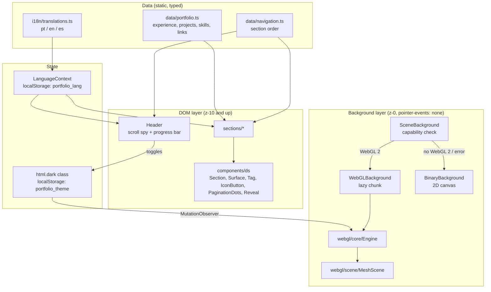
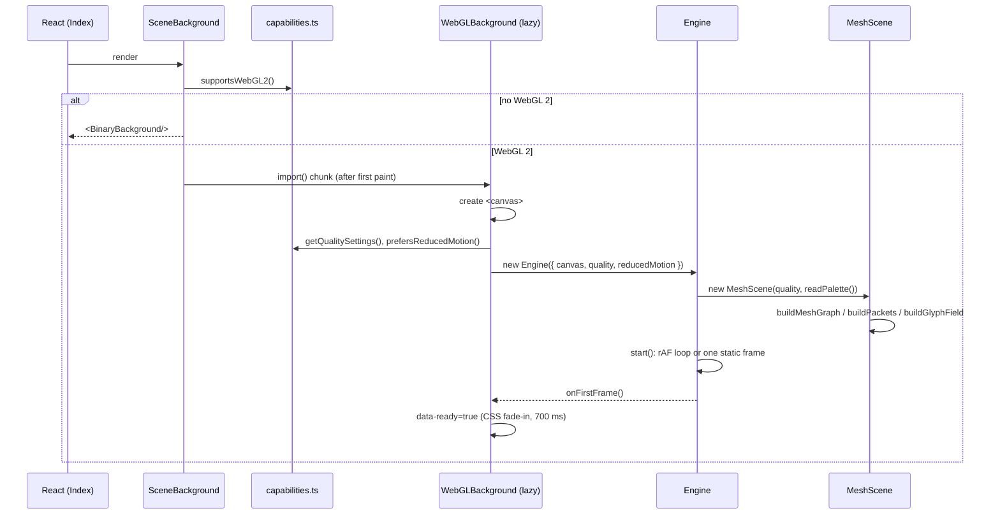

# Architecture

System design of `whoami`: a static React SPA on GitHub Pages with a WebGL background layer. This document covers the runtime layers, the WebGL engine, data flow, performance budget and failure handling. Visual rules live in [DESIGN_SYSTEM.md](DESIGN_SYSTEM.md).

## 1. Runtime layers



The DOM and the background never talk to each other through React. The engine reads two global signals on its own: the `dark` class on `<html>` (theme) and `window.scrollY` (scroll progress). That keeps React renders and GPU frames independent: scrolling re-renders nothing in React, and a language switch costs the GPU nothing.

## 2. Module map

| Path | Responsibility | Imports three.js |
| :--- | :--- | :---: |
| `src/components/scene/SceneBackground.tsx` | Picks WebGL or 2D. Holds the error boundary. | no |
| `src/components/scene/WebGLBackground.tsx` | Creates the canvas, constructs and disposes the engine. Lazy chunk. | yes |
| `src/components/BinaryBackground.tsx` | 2D canvas binary rain. Fallback only. | no |
| `src/webgl/core/capabilities.ts` | WebGL 2 probe, device profile, quality tiers, reduced-motion query. | no |
| `src/webgl/core/Engine.ts` | Renderer, camera rig, frame loop, resize, visibility, context loss. | yes |
| `src/webgl/core/input.ts` | Pointer and scroll tracking with frame-rate independent smoothing. | no |
| `src/webgl/core/governor.ts` | Adaptive pixel ratio from measured frame time. | no |
| `src/webgl/core/palette.ts` | CSS HSL tokens to sRGB triples. Theme watcher. | no |
| `src/webgl/core/random.ts` | Seeded PRNG, so the layout is identical on every load. | no |
| `src/webgl/scene/graph.ts` | Pure geometry: clusters, edges, packets, glyph field. | no |
| `src/webgl/scene/shaders.ts` | GLSL for the four layers. | no |
| `src/webgl/scene/MeshScene.ts` | Builds GPU buffers and materials. Per-frame uniforms. | yes |
| `src/lib/motion.ts` | `damp`, `scrollProgress`. Shared by DOM and engine. | no |
| `src/hooks/useActiveSection.ts` | Scroll spy for the nav. | no |

Rule: only `Engine.ts`, `MeshScene.ts` and `WebGLBackground.tsx` may import `three`. Everything else stays in the main bundle or in unit tests without a GPU.

## 3. WebGL engine

### 3.1 Boot sequence



The canvas is created inside the effect instead of being rendered by React. `dispose()` calls `forceContextLoss()` to release GPU memory right away, and a canvas with a lost context cannot host a second renderer. A fresh canvas per mount makes remounts (HMR, route changes) safe.

### 3.2 Scene graph

```
Scene
└── root (MeshScene)
    ├── field     Points        binary glyphs, static, renderOrder -1
    └── layout    Group         rotation.z = 90° on portrait screens
        └── mesh  Group         spins with time and scroll
            ├── Points          nodes (gateways + pods)
            ├── LineSegments    edges (backbone + local)
            └── Points          packets
```

Four draw calls per frame. All motion runs in vertex shaders from one `uTime` uniform:

| Layer | Vertex shader work | Fragment shader work |
| :--- | :--- | :--- |
| Nodes | Pulse size from `sin(uTime + phase)`, depth fade | Soft disc, signal ring on gateways |
| Edges | Depth fade | Flat color, backbone tinted toward signal |
| Packets | `mix(start, end, fract(uTime * speed + phase))` | Soft dot, fades in and out along the edge |
| Glyphs | Wrap `y` with `mod`, flip `0`/`1` from a hashed time step | Sample a two-cell atlas texture |

Packets cost no CPU per frame: each packet stores its edge endpoints as attributes and the GPU computes its position.

### 3.3 Frame loop

Per frame the CPU does this and nothing more:

1. `InputTracker.update(delta)`: damp pointer (λ=3) and scroll (λ=5) toward their targets.
2. Camera rig: pointer parallax (±1.4 x, ±0.9 y), descent `-1.5 * scroll`, dolly `-3.5 * sin(π * scroll)`.
3. `MeshScene.update`: write `uTime`, set mesh rotation from time and scroll, scale layer opacity (100% behind the hero, 60% behind reading content).
4. `renderer.render()`.
5. `PerformanceGovernor.sample(delta)`: may lower the pixel ratio.

### 3.4 Render modes

| Condition | Mode |
| :--- | :--- |
| Default | `requestAnimationFrame` loop |
| `prefers-reduced-motion: reduce` | One static frame (time 0, no parallax, no scroll motion). Re-rendered only on resize or theme change. Switches live when the OS setting changes. |
| `document.hidden` | Loop stopped. Governor window reset on return so the pause does not count as a slow frame. |
| `webglcontextlost` | Loop stopped. `webglcontextrestored` starts it again; three.js re-uploads buffers. |

## 4. Data flow

### Theme

```
Header click → html.classList.toggle("dark") → localStorage
                                   │
                                   ├── CSS variables switch (DOM repaints)
                                   └── MutationObserver (palette.ts)
                                         → readPalette(): --foreground, --signal → sRGB
                                         → MeshScene.setPalette(): uniforms + blending
                                         → Engine.invalidate()
```

Dark mode draws nodes and packets with additive blending (they glow). Light mode uses normal alpha blending, since adding light to a light background does nothing visible. Shaders skip three's color space conversion, so a token like `--signal: 172 66% 52%` produces the same pixel on the canvas and in the DOM.

### Scroll

One scroll position drives three consumers, each on its own schedule:

| Consumer | Mechanism | React re-render |
| :--- | :--- | :---: |
| WebGL camera and mesh | `InputTracker`, smoothed per frame | no |
| Header progress bar | rAF-throttled listener writes `transform` | no |
| Nav active state | rAF-throttled `getBoundingClientRect` on 6 sections | only when the active id changes |

## 5. Performance budget

### Bundle

| Chunk | Minified | Gzip | Loaded |
| :--- | ---: | ---: | :--- |
| `index-*.js` | 367 kB | 117.6 kB | Always (114.5 kB gzip before this change: +3.1 kB) |
| `WebGLBackground-*.js` | 537 kB | 136 kB | Lazy, only on WebGL 2 devices, after first paint |
| `index-*.css` | 40 kB | 7.9 kB | Always |

### Quality tiers

`pickQualityTier()` reads `hardwareConcurrency`, `deviceMemory`, pointer type and width:

| Tier | Selected when | Max pixel ratio | Clusters × nodes | Glyphs | MSAA |
| :--- | :--- | ---: | ---: | ---: | :---: |
| low | ≤ 4 cores or ≤ 2 GB | 1 | 5 × 9 | 220 | no |
| medium | touch, < 768 px wide, or ≤ 4 GB | 1.5 | 6 × 13 | 480 | yes |
| high | everything else | 2 | 7 × 18 | 900 | yes |

Measured output of the generator per tier (seeded, so identical on every load):

| Tier | Nodes | Edges (backbone) | Packets | Glyphs |
| :--- | ---: | ---: | ---: | ---: |
| low | 45 | 54 (7) | 56 | 220 |
| medium | 78 | 102 (8) | 95 | 480 |
| high | 126 | 164 (10) | 143 | 900 |

Every tier renders in 4 draw calls.

### Adaptive resolution

`PerformanceGovernor` averages frame time over 90 frames. Above the budget (1/45 s) it lowers the pixel ratio by 0.25, down to 1. It never raises it again, so the resolution cannot oscillate.

The renderer requests `powerPreference: "low-power"`, so laptops with two GPUs stay on the integrated one for a background effect.

## 6. Failure modes

| Failure | Detection | Result |
| :--- | :--- | :--- |
| No WebGL 2 (old browser, blocklisted GPU, jsdom) | `supportsWebGL2()` probe | 2D `BinaryBackground` |
| Lazy chunk fails to download | `FallbackBoundary` error boundary | 2D `BinaryBackground` |
| Renderer or shader setup throws | `try/catch` around `new Engine()` → `onError` | 2D `BinaryBackground` |
| GPU context lost at runtime | `webglcontextlost` | Loop pauses, resumes on restore |
| Slow GPU | Governor | Lower pixel ratio |
| Web font loads late | `document.fonts.load()` | Glyph atlas redraws once |

The page content never depends on the background. Every failure path ends with a working page.

## 7. Accessibility

- Both background layers are `aria-hidden` and `pointer-events: none`.
- Reduced motion freezes the WebGL scene, stops carousel autoplay and turns all CSS transitions and animations into instant changes (`index.css`).
- The hero has a radial scrim behind its copy so text contrast does not depend on where the mesh sits.
- Nav links set `aria-current` from the scroll spy. Sections are `aria-labelledby` their numbered heading.

## 8. Testing

| Suite | Covers |
| :--- | :--- |
| `webgl.test.ts` | PRNG determinism, tier selection, HSL parsing, damping, governor, graph invariants (unique edges, every node connected, backbone first), packets, glyph bounds |
| `DesignSystem.test.tsx` | Primitives (semantics, variants, pointer spotlight) and the WebGL to 2D fallback |
| `PortfolioSections.test.tsx`, `Header.test.tsx`, `NotFound.test.tsx`, `LanguageContext.test.tsx` | Page content, i18n, theme toggle |

jsdom has no WebGL, so tests run the fallback path. GPU code stays thin: geometry is generated by pure functions in `graph.ts`, and those carry the tests.

## 9. Build and deploy

| Step | Command | Notes |
| :--- | :--- | :--- |
| Sitemap | `prebuild` | `scripts/generate-sitemap.ts` |
| Bundle | `vite build` | `base` from `VITE_BASE_PATH` (`/whoami/` in CI) |
| SPA fallback | `postbuild` | copies `index.html` to `404.html` |
| CI | `.github/workflows/ci.yml` | typecheck (app + node configs), lint, test, build |
| Deploy | `.github/workflows/deploy.yml` | GitHub Pages on push to `main` |

## 10. Extending

**New scene layer.** Generate its buffers in `graph.ts` as a pure function and test it. Add GLSL to `shaders.ts`. In `MeshScene`, create it through `this.material()` and `this.geometry()` so it shares `uTime`, `uProjScale`, `uFade` and the palette uniforms and gets disposed. Add its base opacity per theme to `LAYER_OPACITY`.

**New page section.** Add the id to `NAV_ITEMS` in `data/navigation.ts` (this sets its `0N` index and nav position), add the `nav.<id>` key in all three languages, and build the section with `<Section id index title>`.
