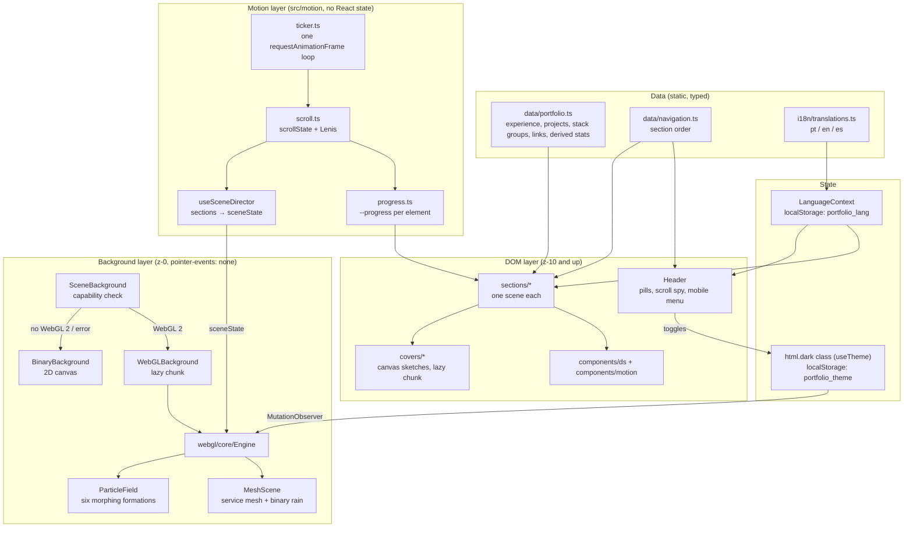
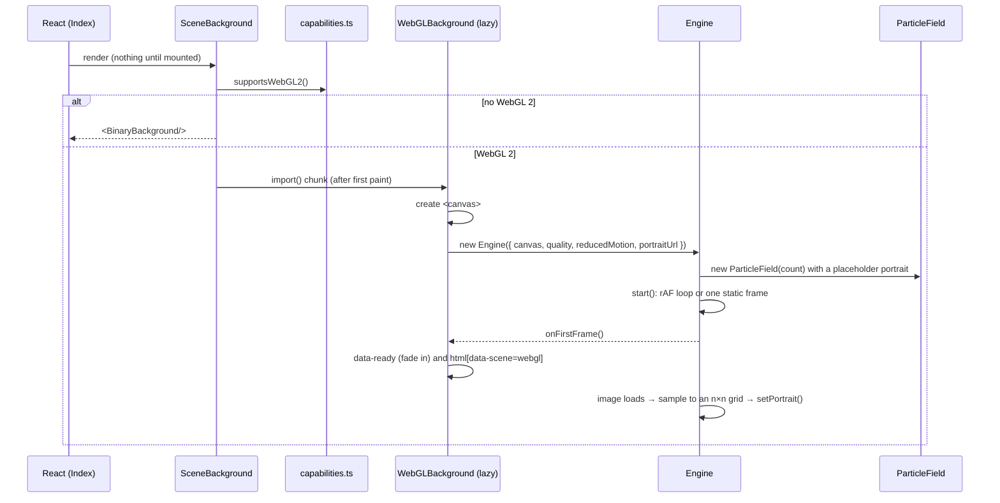

# Architecture

System design of `whoami`: a React SPA on GitHub Pages, prerendered at build time, presented as a sequence of scenes over a WebGL layer, with agent-readable Markdown files. This document covers the runtime layers, the motion layer, the WebGL engine, data flow, performance budget and failure handling. Visual rules live in [DESIGN_SYSTEM.md](DESIGN_SYSTEM.md).

## 1. Runtime layers



React renders content and nothing else. Everything that changes per frame (scroll position, progress, pointer, formation) lives in plain objects and CSS variables, so scrolling re-renders no component. The DOM and the engine meet in one place: `sceneState`, a plain object the DOM writes and the engine reads.

## 2. Module map

| Path | Responsibility | Imports three.js |
| :--- | :--- | :---: |
| `src/motion/ticker.ts` | Single rAF loop with priorities (scroll → progress → scene → ui). Runs only while something is registered. | no |
| `src/motion/scroll.ts` | `scrollState` (y, velocity, direction, progress), Lenis start/stop, `scrollToTarget`, scroll lock. | no |
| `src/motion/progress.ts` | Per-element scroll progress in three modes, written to a CSS variable. Measured only near the viewport. | no |
| `src/motion/observe.ts` | Pooled `IntersectionObserver`s (one per option set). | no |
| `src/motion/sceneState.ts` | DOM → engine bridge and `computeMorph` (scroll position → formation). | no |
| `src/motion/useSceneDirector.ts` | Reads `[data-scene]` sections and the `[data-portrait-stage]` box each frame. | no |
| `src/motion/viewTransition.ts` | View Transitions API wrapper (circular theme reveal, language cross-fade). | no |
| `src/components/motion/*` | `SmoothScroll`, `ScrubText`, `Marquee`, `Counter`, `Magnetic`, `Tilt`, `Scramble`, `Cursor`, `Grain`. | no |
| `src/components/ds/*` | `Section`, `SectionHeading`, `Surface`, `Tag`, `IconButton`, `PaginationDots`, `Reveal`. | no |
| `src/components/covers/algorithms.ts` | A* for the 8-puzzle, AVL insertion, Zhang-Suen thinning, Fuzzy C-Means, nearest neighbours, as pure functions. | no |
| `src/components/covers/sketches.ts` | One canvas sketch per featured project. Lazy chunk. | no |
| `src/components/covers/ProjectCover.tsx` | Creates the canvas and loads the sketch when the card is first visible. | no |
| `src/components/scene/SceneBackground.tsx` | Picks WebGL or 2D. Holds the error boundary. | no |
| `src/components/scene/WebGLBackground.tsx` | Creates the canvas, constructs and disposes the engine. Lazy chunk. | yes |
| `src/webgl/core/Engine.ts` | Renderer, camera rig, frame loop, resize, visibility, context loss, portrait sampling. | yes |
| `src/webgl/scene/MeshScene.ts` | Service mesh and binary rain: buffers, materials, per-frame uniforms. | yes |
| `src/webgl/scene/ParticleField.ts` | The morphing particle field: one `Points`, one shader. | yes |
| `src/webgl/scene/graph.ts`, `particles.ts` | Pure geometry: clusters, edges, packets, glyphs, haze, portrait grid, `meshPresence`. | no |
| `src/webgl/scene/shaders.ts` | GLSL for the five layers. | no |
| `src/webgl/core/capabilities.ts`, `input.ts`, `governor.ts`, `palette.ts`, `random.ts` | Device tiers, pointer tracking, adaptive pixel ratio, CSS tokens → sRGB, seeded PRNG. | no |
| `src/hooks/useTheme.ts` | Theme state, storage, favicon, view transition. | no |
| `src/i18n/routes.ts` | Language ↔ URL (`/`, `/pt/`, `/es/`), `<html lang>` values, base stripping. | no |
| `src/entry-server.tsx`, `scripts/prerender.ts` | Build-time render of the home page, once per language. | no |
| `src/seo/head.ts`, `jsonld.ts`, `sitemap.ts` | The generated `<head>` block, the JSON-LD graph and the sitemap, per language. | no |
| `src/seo/llms.ts`, `resume.ts`, `files.ts` | llms.txt, llms-full.txt, Markdown profiles and JSON Resume from portfolio data. | no |
| `scripts/generate-head.ts`, `generate-sitemap.ts`, `generate-llms.ts` | Write those outputs to `index.html` and `public/` (`npm run generate`). | no |
| `src/agents/webmcp.ts`, `useAgentTools.ts` | WebMCP tools registered on the page for browser agents. | no |

Rule: only `Engine.ts`, `MeshScene.ts`, `ParticleField.ts` and `WebGLBackground.tsx` may import `three`. Everything else stays in the main bundle or runs in unit tests without a GPU.

## 3. Motion layer

### 3.1 One loop

`addTick(fn, priority)` registers a per-frame callback. Lower priorities run first:

| Priority | Who | Does |
| ---: | :--- | :--- |
| 0 `scroll` | `scroll.ts` | Advances Lenis, samples `window.scrollY`, smooths velocity |
| 10 `progress` | `progress.ts` | Re-measures tracked elements, only if the scroll or the viewport changed |
| 20 `scene` | `useSceneDirector` | Writes `sceneState.morph` and the portrait frame |
| 30 `ui` | components | Header hide, progress bar, cursor, magnets, tilt, marquee rate, gallery track, covers |

The WebGL engine keeps its own loop in its own chunk and reads `sceneState` and `scrollState`.

### 3.2 Scroll

Lenis runs on devices with a mouse or trackpad and no reduced-motion preference. It animates the real scroll position, so `position: sticky`, anchors and `window.scrollY` keep working, and it handles in-page anchor clicks. Touch devices keep native scrolling.

`trackProgress(element, { mode })` gives each tracked element a 0..1 value:

| Mode | 0 when | 1 when | Used by |
| :--- | :--- | :--- | :--- |
| `view` | top enters the viewport bottom | bottom leaves the viewport top | Experience marker, role focus |
| `contain` | top reaches the viewport top | bottom reaches the viewport bottom | About pin, Projects pin |
| `exit` | top is at the viewport top | element has scrolled past | Hero recede |

Pinned scenes are plain CSS: a tall wrapper with a `position: sticky` child. No scroll hijacking. The page wrapper uses `overflow-x: clip`, because `overflow: hidden` on an ancestor would break sticky.

### 3.3 Server-safe by construction

Every motion component renders its final, visible state. Effects add the motion after mount, and only when the feature it needs exists:

| Component | Static HTML / no feature | With the feature |
| :--- | :--- | :--- |
| `Reveal` | Visible | Hidden only if it starts below the fold, shown on first intersection |
| `ScrubText` | Fully lit (`--scrub` falls back to 1) | Words light up with the pin's progress |
| `Marquee` | Content once, standing still | Second copy added on first intersection, then loops |
| `Counter` | Final number | Counts up on first intersection |
| `ProjectsSection` | Horizontal scroll-snap strip | Pinned gallery on mouse devices at `lg` and up |
| `ProjectCover` | Styled empty box | Canvas and sketch created on first intersection |
| Hero entrance | CSS keyframes, runs without JS | Same |

That keeps the prerendered HTML readable for agents and for people without JavaScript, and it is what makes hydration match (see §9).

## 4. WebGL engine

### 4.1 Boot sequence



The canvas is created inside the effect instead of being rendered by React. `dispose()` calls `forceContextLoss()` to release GPU memory right away, and a canvas with a lost context cannot host a second renderer.

`html[data-scene="webgl"]` tells CSS the particle portrait is live, so the image fallback in About fades out. It is set only in the animated mode.

### 4.2 Scene graph

```
Scene
├── root (MeshScene)
│   ├── field     Points        binary glyphs, renderOrder -1
│   └── layout    Group         offset to the right in the hero; 90° on portrait screens
│       └── mesh  Group         spins with time and scroll, scales with presence
│           ├── Points          nodes (gateways + pods)
│           ├── LineSegments    edges (backbone + local)
│           └── Points          packets
└── points (ParticleField)      one Points, renderOrder 1
```

Five draw calls per frame. All motion runs in vertex shaders.

### 4.3 Particle field

One buffer of particles (4,096 / 8,464 / 17,424 by tier) holds two stored positions per particle, the haze and the portrait grid cell, plus four random seeds. The other four formations are computed in the vertex shader from the seeds, so they cost no memory and can move with time.

`uMorph` (0..5) selects the formation. Tent weights blend the two neighbours:

```
weight_i = max(0, 1 − |m − i|)        position = Σ weight_i · formation_i
```

`m` is `uMorph` with a per-particle stagger that vanishes at whole numbers, so particles leave one after another but every integer value is an exact formation. Mid-transition a swirl term proportional to `sin(π·t)` bends the paths.

| # | Formation | Source |
| ---: | :--- | :--- |
| 0 | Haze | `position` attribute; one particle in eight is lit |
| 1 | Portrait | `aPortrait` + `aTone`, placed by `uFrame` |
| 2 | Terrain | Seeds → 44 rows of dots on a rolling plane, with a horizon fade |
| 3 | Globe | Seeds → 13 latitude rings and 20 meridians, low in the frame so the text above stays clear |
| 4 | Tunnel | Seeds → ring at the viewport edges; `uTravel` advances with scroll velocity |
| 5 | Galaxy | Seeds → three-armed spiral disc seen at a shallow angle |

**Lens.** Each point has a sharp size and a blur radius `aperture · |depth − focus| / depth`. The drawn size is their sum, and alpha falls with `(sharp / size)^1.35`, so a defocused point spreads the same light over a larger disc. The fragment shader switches from a soft dot to a flat disc with a bright rim as blur grows.

**Portrait.** `Engine.loadPortrait` crops a square around the head and shoulders, lets a 2D canvas downsample it to the grid resolution (√count), and `buildPortrait` turns each pixel into a dot: x/y from the cell, z from luminance (relief), tone from luminance through a midtone lift, mask from an elliptical vignette. On dark the tone is used as is; on light it is inverted, so both themes show a positive image.

**Pointer.** Particles within reach of the pointer are pushed away and toward the camera. The strength follows `InputTracker.pointerPresence`, which rises while a mouse moves and decays when it rests.

### 4.4 Which formation, and where

`useSceneDirector` caches the document-space top of every `[data-scene]` section (re-read when the layout changes) and calls:

```
computeMorph(sections, scrollY, viewport)
```

Each section holds its formation while it fills the screen. The blend to the next one happens while that section's top edge crosses the middle of the viewport. Two neighbouring sections with the same formation (Education and Skills) do not move it. The engine damps the value (λ = 3.4), so a fast scroll still flows through the formations.

While the portrait formation is near, the director also reports the bounding box of `[data-portrait-stage]` in normalized device coordinates. The engine converts it to world units at the focal plane, so the particle portrait sits exactly where the layout put the stage, on any screen.

The service mesh fades with `meshPresence(morph)`: full in the hero, gone from About to Projects, back at 85% for Contact.

### 4.5 Render modes

| Condition | Mode |
| :--- | :--- |
| Default | `requestAnimationFrame` loop |
| `prefers-reduced-motion: reduce` | One static frame (time 0, formation 0, no pointer), drawn at 50% opacity. Re-rendered only on resize or theme change. Switches live when the OS setting changes. |
| `document.hidden` | Loop stopped. Governor window reset on return. |
| `webglcontextlost` | Loop stopped. `webglcontextrestored` starts it again; three.js re-uploads buffers. |

## 5. Data flow

### Theme

```
Header click → useTheme.toggle(origin)
  → runViewTransition: the new theme grows as a circle from the button
      → html.classList.toggle("dark"), localStorage, favicon
          ├── CSS variables switch (DOM repaints)
          ├── MutationObserver (palette.ts) → uniforms and blending → one frame
          └── MutationObserver (ProjectCover) → sketch colors
```

Dark mode draws nodes, packets and particles with additive blending (they glow). Light mode uses normal blending and a higher particle opacity, since ink has to be dense to read on a pale page. Shaders skip three's color space conversion, so a token like `--signal: 172 66% 52%` produces the same pixel on the canvas and in the DOM.

Language changes go through the same wrapper without an origin, which gives a short cross-fade.

### Language

Each language has its own URL: `/` (English), `/pt/` and `/es/`. The three routes render the same `Index` element, so a switch changes the address without remounting the page.

```
Request /pt/ → prerendered dist/pt/index.html → hydrate with routeLanguage = "pt"
Header click → setLanguage("es") → localStorage
  → LanguageRouteSync: navigate("/es/", { replace: true })
  → LanguageProvider effect: <html lang>
  (title and meta tags stay those of the page that was loaded; each URL is prerendered with its own)
```

The URL wins over the saved language. At `/` a returning visitor with a saved language is moved to that language's URL after hydration. `LanguageRouteSync` sits inside `AppRoutes`, so the server and the client render the same tree.

### Scroll

One scroll position, sampled once per frame, drives everything:

| Consumer | Mechanism | React re-render |
| :--- | :--- | :---: |
| Formation and portrait placement | `useSceneDirector` → `sceneState` → engine | no |
| Hero recede, About words, year marker, role focus | `trackProgress` → CSS variables | no |
| Project gallery | `trackProgress` → `transform` on the track; skew from velocity | only when the active card changes |
| Header hide, reading progress bar, marquee rate | `scrollState` in a tick | no |
| Nav active state | rAF-throttled `getBoundingClientRect` on 6 sections | only when the active id changes |

## 6. Performance budget

### Bundle (production build, base `/whoami/`)

| File | Minified | Gzip | Loaded |
| :--- | ---: | ---: | :--- |
| `index.html` (prerendered, one per language) | 158 kB | 22.5 kB | Always; full page content as HTML |
| `index-*.js` | 324 kB | 103.9 kB | Always. React, router, Lenis, motion layer, sections, portfolio data. |
| `index-*.css` | 51 kB | 13.5 kB | Always. Includes the `@font-face` rules. |
| `WebGLBackground-*.js` | 548 kB | 139.9 kB | Lazy, only on WebGL 2 devices, after first paint |
| `sketches-*.js` | 18.4 kB | 7.7 kB | Lazy, when the first project card nears the viewport |
| Fonts (latin woff2) | 22 + 40 + 22 kB | | Space Grotesk preloaded; mono and serif on demand |

### Quality tiers

`pickQualityTier()` reads `hardwareConcurrency`, `deviceMemory`, pointer type and width:

| Tier | Selected when | Max pixel ratio | Mesh nodes | Glyphs | Particles (portrait grid) | MSAA |
| :--- | :--- | ---: | ---: | ---: | ---: | :---: |
| low | ≤ 4 cores or ≤ 2 GB | 1 | 45 | 220 | 4,096 (64²) | no |
| medium | touch, < 768 px wide, or ≤ 4 GB | 1.5 | 78 | 480 | 8,464 (92²) | yes |
| high | everything else | 2 | 126 | 900 | 17,424 (132²) | yes |

Measured in headless Chrome on the development machine (Apple GPU, 1440 × 900 at pixel ratio 2, high tier): 60 fps in every scene.

### Adaptive resolution

`PerformanceGovernor` averages frame time over 90 frames. Above the budget (1/45 s) it lowers the pixel ratio by 0.25, down to 1. It never raises it again, so the resolution cannot oscillate. Point sizes are capped at 90 px times the pixel ratio, which bounds the fill cost of bokeh discs.

The renderer requests `powerPreference: "low-power"`, so laptops with two GPUs stay on the integrated one.

### What only runs when needed

- The ticker stops when nothing is registered. Magnets and tilt register on hover and remove themselves when they settle.
- Progress is measured only for elements within 30% of the viewport, and only on frames where the scroll or the viewport changed.
- Covers animate only while their card intersects the viewport. Marquees loop only after they have been seen.

## 7. Failure modes

| Failure | Detection | Result |
| :--- | :--- | :--- |
| No WebGL 2 (old browser, blocklisted GPU, jsdom) | `supportsWebGL2()` probe | 2D `BinaryBackground`; About shows the halftone photo |
| Lazy chunk fails to download | `FallbackBoundary` error boundary | Same |
| Renderer or shader setup throws | `try/catch` around `new Engine()` → `onError` | Same |
| Portrait image fails to load | `onload` never fires | Placeholder gradient stays in formation 1 |
| GPU context lost at runtime | `webglcontextlost` | Loop pauses, resumes on restore |
| Slow GPU | Governor | Lower pixel ratio |
| No `IntersectionObserver` | `supportsObserver()` | Content stays visible and still; covers stay empty boxes |
| No View Transitions API | feature check | Theme and language switch instantly |
| Clipboard unavailable | `try/catch` | The mailto link still works |
| No WebMCP (`document.modelContext` missing) | feature check | No tools registered; agents read the static files |
| JavaScript disabled | | Prerendered page with the CSS hero entrance; gallery is a scroll strip |

The page content never depends on the background or on motion. Every failure path ends with a readable page.

## 8. Testing

| Suite | Covers |
| :--- | :--- |
| `webgl.test.ts` | PRNG, tier selection, HSL parsing, damping, governor, mesh graph invariants |
| `covers.test.ts` | A* (valid moves, length within bounds), AVL (balanced, ordered), Zhang-Suen (one piece, one pixel wide), Fuzzy C-Means, nearest neighbours, particle buffers, portrait tone mapping, mesh presence, a sketch for every featured project |
| `motion.test.tsx` | Progress modes, `computeMorph` (plateaus, blends, monotonic), motion components without `IntersectionObserver`, hero name semantics, mobile menu, gallery, contact copy, derived stats |
| `DesignSystem.test.tsx` | Primitives, the WebGL to 2D fallback, carousel autoplay and reduced motion |
| `PortfolioSections.test.tsx`, `Header.test.tsx`, `NotFound.test.tsx`, `LanguageContext.test.tsx` | Page content, i18n, aria labels, theme toggle |
| `prerender.node.test.tsx`, `prerender.test.tsx` | Server render in Node; hydration without mismatches at `/` and `/pt/`, for a returning visitor, and the URL following the language |
| `llms.test.ts`, `seo.test.ts` | Agent files, `index.html` and the sitemap against the data (drift fails), language routes, hreflang, JSON-LD, JSON Resume, no phone number in any output |
| `webmcp.test.ts` | Tool definitions, their output per language, registration and cleanup |

jsdom has no WebGL and no `IntersectionObserver`, so component tests run the static path, which is the same one the prerender and no-JS visitors get. GPU and canvas code stays thin: geometry and algorithms are pure functions, and those carry the tests.

Visual checks use the real build in Chrome (headless with the GPU enabled): desktop, laptop, tablet and phone sizes, both themes, reduced motion.

## 9. Build and deploy

| Step | Command | Notes |
| :--- | :--- | :--- |
| Head, sitemap, agent files | `prebuild` (`npm run generate`) | `generate-head.ts` rewrites the block between the `seo:start` and `seo:end` markers in `index.html`; `generate-sitemap.ts` and `generate-llms.ts` write to `public/` |
| Client bundle | `vite build` | `base` from `VITE_BASE_PATH` (`/whoami/` in CI). A small plugin adds the display-font preload. |
| Server entry | `vite build --ssr src/entry-server.tsx` | to `dist-ssr/`, removed after prerender |
| Prerender + SPA fallback | `postbuild` | `scripts/prerender.ts`: `404.html` = empty shell; `index.html`, `pt/index.html`, `es/index.html` = the home page in each language with its own `<html lang>` and head block |
| CI | `.github/workflows/ci.yml` | typecheck (app + node configs, incl. scripts), lint, test, build |
| Deploy | `.github/workflows/deploy.yml` | GitHub Pages on push to `main` |

### Prerender and hydration rules

`main.tsx` hydrates on the three home routes and renders from scratch elsewhere. Hydration needs the first client render to match the build output, so **no component may read browser state (localStorage, matchMedia, WebGL, window size, the clock) during its first render**. Read it in an effect instead, as `useTheme`, `LanguageContext`, `SceneBackground`, `Reveal`, `ProjectsSection` (pinned mode) and `LocalClock` do. Imperative DOM writes (`data-visible`, `--progress`, cover canvases) happen after mount and on attributes React does not manage. The inline script in `index.html` sets the `dark` class before paint. `src/test/prerender.test.tsx` fails on any mismatch.

### Search, agent and crawler surface

Everything below is generated from `src/data/portfolio.ts` and `src/i18n/translations.ts`. The generated files are committed, and the tests fail when they drift from the data.

**Search engines (SEO).**

| Output | Content |
| :--- | :--- |
| `/`, `/pt/`, `/es/` | One prerendered page per language, each with its own title, description, canonical URL and `<html lang>` |
| hreflang links | `en`, `pt-BR`, `es` and `x-default` on every page, and the same alternates in `sitemap.xml` |
| JSON-LD `@graph` | `WebSite`, `ProfilePage`, `Person` (employer, schools, languages, `sameAs`) and an `ItemList` of `SoftwareSourceCode` |
| `sitemap.xml` | The three URLs. `lastmod` is `profile.updatedAt`, so the file only changes when the content does |
| `og-image.png`, Open Graph, Twitter card | 1200x630 share card with localized text fields |
| `rel="me"` | One link per public profile in `socialLinks` |
| `site.webmanifest`, image preload | Linked from the static part of `index.html`, so Vite applies the base path |

**Agents that read files (AXO).**

| File | Content |
| :--- | :--- |
| `llms.txt` | llmstxt.org index: summary, a key-facts list (current role, location, last update), then profile / project / contribution / contact links and `## Optional` |
| `index.md`, `index.pt.md`, `index.es.md` | The home page as Markdown per language |
| `llms-full.txt` | All three profiles in one file |
| `resume.json`, `resume.pt.json`, `resume.es.json` | JSON Resume 1.0.0: work, education, projects, skills, languages, certificates |

Every page links its own Markdown and JSON Resume with `rel="alternate"`, and `llms.txt` with `rel="describedby"` (GitHub Pages cannot send Link headers).

**Agents that act in the browser (ARO).** `useAgentTools` registers four WebMCP tools on `document.modelContext` when the browser has it: `get_profile` (Markdown, any of the three languages), `list_projects` (projects and contributions as JSON), `get_contact`, and `go_to_section` (scrolls the page). The tools return the same data as the files. They are removed on unmount through an `AbortSignal`. WebMCP is experimental (Chrome behind `--enable-experimental-web-platform-features`); without it nothing is registered.

**Limits.** robots.txt under `/whoami/` is not read by crawlers (only the domain root counts); submit the sitemap in Search Console instead. Private repositories carry no `githubUrl`, so no output links to them. No phone number or street address is in the data, and `seo.test.ts` checks the outputs for one.

## 10. Extending

**New particle formation.** Add a `form…()` function to `dustVertex` that builds a position from `aSeed`, give it a tent weight and a layer opacity in `main()`, and raise the clamp in `ParticleField.update`. Point a section at it with `data-scene`. Keep formations behind reading text below 55% opacity.

**New mesh layer.** Generate its buffers in `graph.ts` as a pure function and test it. Add GLSL to `shaders.ts`. In `MeshScene`, create it through `this.material()` and `this.geometry()` so it shares the uniforms and gets disposed.

**New page section.** Add the id to `NAV_ITEMS` in `data/navigation.ts` (this sets its `0N` index and nav position), add the `nav.<id>` key in all three languages, build it with `<Section id index title scene>` or compose `SectionHeading` in a custom layout, and render the final state first.

**New project.** Add it to `projects` in `data/portfolio.ts`. With `featured: true` it joins the gallery and needs a sketch under the same id in `covers/sketches.ts` (`covers.test.ts` fails until it has one). Without it, the project is a row under "More projects". Leave `githubUrl` out for a private repository. Update `portfolioStats`, bump `profile.updatedAt` and run `npm run generate`.

**New contribution.** Add a merged pull request to `contributions` in `data/portfolio.ts` (repository, URL, merge month, description in three languages). Text between backticks renders as code on the page and stays Markdown in the agent files.

**New language.** Add it to `Language`, `LANGUAGE_PATHS` and `HTML_LANG` in `i18n/routes.ts`, a route in `AppRoutes`, every key in `translations.ts` and every localized field in `portfolio.ts`. The prerender, head, sitemap and agent files loop over `LANGUAGES`.
